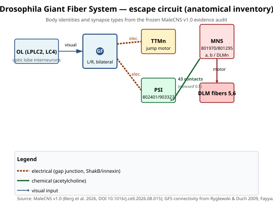
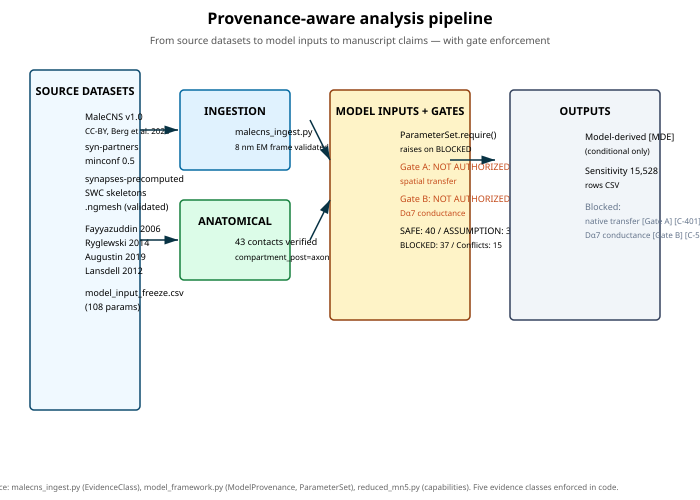
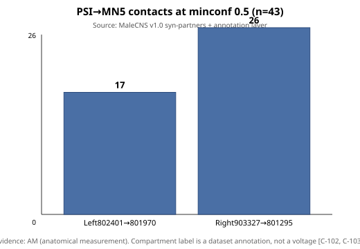
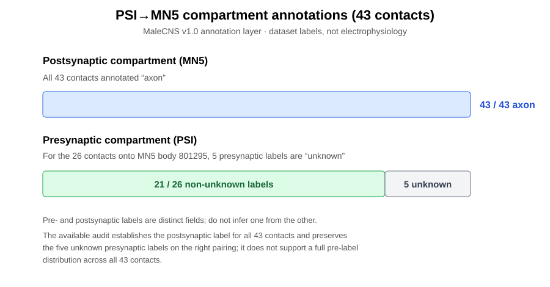
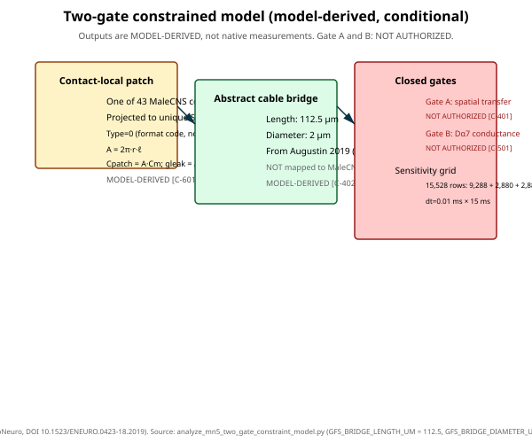
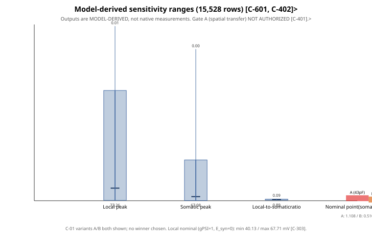
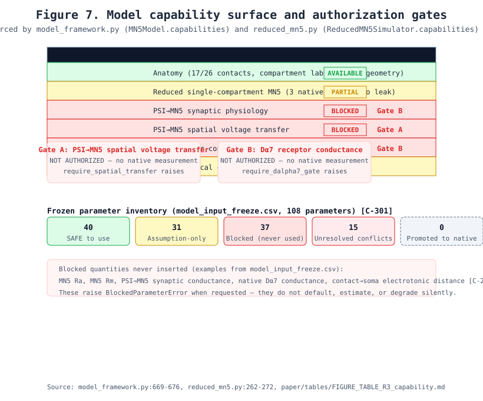
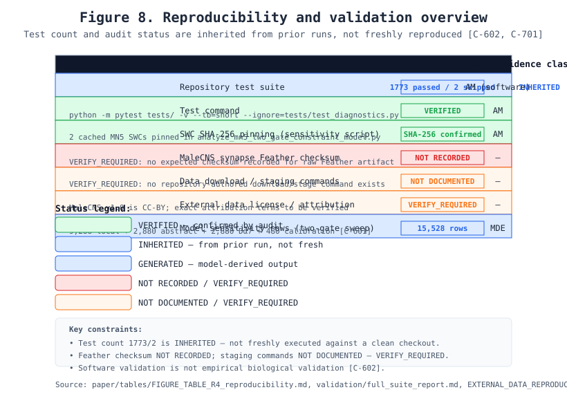

> **REVIEW ONLY — NOT FOR SUBMISSION**  
> Assembled automatically from the branch's draft sources for editorial review. Author, affiliation, funding, acknowledgements, reference metadata, figure/table placement, and journal formatting have not been finalized. Do not treat this file or its rendered PDF as a submission-ready manuscript.

# Audited anatomy, conditional modeling, and open measurements for the *Drosophila* PSI→MN5 escape synapse

**Authors:** [AUTHOR NAMES AND ORDER TO BE CONFIRMED]  
**Affiliations:** [AFFILIATIONS TO BE CONFIRMED]  
**Corresponding author:** [NAME AND EMAIL TO BE CONFIRMED]  
**Manuscript status:** Review draft assembled from current repository section drafts.  
**Source branch:** `review/scientific-claim-corrections`  
**Source commit at assembly:** `109892644b1890bedd72e6152f7590cb4b930022`

---

# Abstract

We present a provenance-controlled framework for the *Drosophila* PSI→MN5 connection with five code-enforced evidence classes: native experimental measurement (NEM), anatomical measurement (AM), literature-derived passive parameter (LDP), model-derived estimate (MDE), and model assumption (MA). The framework hard-blocks requests for unmeasured native quantities.

MaleCNS v1.0 (Berg et al. 2026) at minconf 0.5 yields 43 PSI→MN5 contacts (17 left, 26 right), all `compartment_post=axon`. SWCs lack a `kind=1` soma node; no anatomically reconstructed contact-to-soma path exists — permanently UNRESOLVED. Contact geometry preserves three distinct metrics (mesh surface, SWC-root path, straight-line to `somaLocation`); none is converted to electrotonic distance.

Admissible native MN5 measurements (Ryglewski et al. 2014; Fayyazuddin et al. 2006): resting potential −67.8 ± 5.5 mV (n=13), spike threshold −24.1 ± 8.2 mV (n=11), AP amplitude +45.5 ± 8.6 mV (n=13), input resistance 102 ± 12 MΩ (n=22) / 97 ± 31 MΩ (n=52). Two capacitance values conflict (43 ± 2 pF vs 127 ± 16 pF; C-01); both retained. The 4.71 ± 0.35 mV somatic EPSP (n=10) was GF-stimulated — a comparison target only. Two 1000× conductance discrepancies (C-02, C-03) preserved unresolved.

Gates NOT AUTHORIZED: Gate A (PSI→MN5 spatial voltage transfer — no native measurement, no Drosophila Ra/Rm/Cm, no soma node) and Gate B (Dα7 conductance — no native MN5 synaptic conductance/density). A conditional two-gate sensitivity sweep (15,528 model-derived rows) produces contact-local, abstract-bridge, and Dα7 outputs explicitly conditional on assumptions — not native measurements or validation.

All outputs are tagged by evidence class; they do not establish biological measurements.

---

# Introduction

This draft is grounded in the frozen evidence base (`research/model_input_freeze.md`, `research/final_anatomy_audit.md`, `research/mn5_psi_mn5_final_constraint_model.md`) and the claim evidence map (`paper/CLAIM_EVIDENCE_MAP.md` `[C-101–C-701]`). Substantive biological framing is tied to claim IDs; provenance classes follow the project's five-class taxonomy.

---

## 1. Biological motivation

The Drosophila Giant Fiber System (GFS) mediates the short-latency takeoff (jump) and escape (flight) response initiated by a looming visual threat detected by the optic lobes `[C-101]`. The principal escape interneuron, the Giant Fiber (GF), descends bilaterally and makes two fast output pathways: a monosynaptic GF→TTMn (jump) pathway and a disynaptic GF→PSI→MN5/DLMn (wing-downstroke) pathway that ultimately drives the dorsal longitudinal wing depressor muscles `[C-101]`. Understanding how a visual threat becomes a motor command requires knowing where and how PSI contacts MN5, and how much of that signal reaches the soma to influence firing `[C-101, C-201]`.

MN5 is the motoneuron that *"innervates the two most dorsal fibers of the dorsal longitudinal wing depressor muscle (DLM)"* — DLM fibers 5 and 6 — contralateral to its soma, a textual assignment from the source literature rather than a project inference `[C-101]`. The two recorded MN5 bodies are identified directly from the MaleCNS v1.0 annotation table: `801970` (left; VFB `VFB_jrmc37jr`) and `801295` (right; VFB `VFB_jrmc37js`) `[C-101]`.

---

## 2. Rationale for combining anatomy, contacts, electrophysiology, and computation

A complete biophysical account of PSI→MN5 transmission must close four gaps in sequence: (1) the exact wiring from PSI to MN5, (2) the geometric relationship of each contact to the MN5 soma, (3) the native electrophysiological parameters of MN5, and (4) a model-based synthesis under declared assumptions `[C-201, C-301, C-401]`.

The MaleCNS v1.0 connectome provides a complete candidate structure for gap (1), but the standard for reporting it is provenance-disciplined: counts must be quoted at a stated minimum-confidence threshold `[C-102]`. Gap (2) requires a reconstructed path from each contact to a labelled soma, which the available skeletons do not supply. Gap (3) is constrained by native whole-cell recordings of MN5 but faces a documented capacitance discrepancy `[C-301, C-303]`. Gap (4) is only meaningful if (2) and (3) can be closed — otherwise it is a conditional, assumption-bounded exercise `[C-201, C-401, C-501]`.

The project therefore treats the four evidence classes separately — native measurement, literature evidence, anatomical data, and model-derived estimate — rather than collapsing them, so that a model-derived sensitivity range is never read back as a native observation `[C-301, C-302, C-402, C-601]`.

---

## 3. Research questions

The manuscript addresses four questions, each answered only where the frozen evidence base permits:

1. **Anatomy**: At minimum confidence 0.5, do the MaleCNS v1.0 synapse and annotation layers agree on the PSI→MN5 contact inventory? `[C-102, C-103]`
2. **Morphology**: Do the MaleCNS MN5 skeletons carry an anatomically reconstructed contact-to-soma path, and how is each contact's SWC Type to be interpreted? `[C-201, C-203]`
3. **Native constraints**: Which native electrophysiological values of MN5 are admissible, and which passive/cable quantities remain unmeasured? `[C-301, C-302, C-303]`
4. **Conditional modeling**: What can an assumption-bounded model produce under explicit bridge geometry, and what must it refuse? `[C-402, C-503, C-601]`

---

## 4. Provenance-aware analysis and authorization gates

The methodological contribution is a **provenance-aware framework** that prevents a blocked quantity from becoming a model constant by accident. Every model input is loaded from `research/model_input_freeze.csv` into a `ParameterSet` that **raises** (`BlockedParameterError`) when a blocked parameter is requested, rather than substituting a value `[C-401, C-501]` (`model_framework.py:ParameterSet.require`). Two gates are enforced at the code level:

- **Gate A — PSI→MN5 spatial voltage transfer: NOT AUTHORIZED.** `require_biological_transfer_authorization()` and `require_spatial_transfer()` both always raise; no code path may claim a measured native transfer `[C-201, C-401]`.
- **Gate B — Dα7 conductance: NOT AUTHORIZED.** `require_dalpha7_gate()` always raises; `Dalpha7Interface.conductance()` calls it `[C-501]`.

This is not a stylistic choice but a scientific one: MN5-specific passive parameters are not uniquely determinable from available evidence — two whole-cell measurements constrain three unknowns (Cm, Rm/g_pas, Ra), no MN5-specific axial resistivity exists (the only measured Drosophila motor-neuron Ra is larval aCC, 212.47 ± 3.69 Ω·cm), the recovered skeleton lacks a soma node, and the somatic capacitance is discrepant by ~3× `[C-201, C-303, C-401]`.

> **Permitted**: "The framework does not infer biological parameters from desired model outputs."

---

## 5. Study scope and what is NOT claimed

**This study establishes** the audited PSI→MN5 contact inventory (43 contacts, 17 left / 26 right, at minconf 0.5), the official `compartment_post` labels (all `axon`), the preserved native MN5 voltage measurements and their conflicts, the geometric contact-to-root paths, and the structure of a provenance-separated conditional model `[C-101, C-102, C-103, C-201, C-301, C-303, C-601]`.

**This study does NOT claim**: a measured native contact-to-soma voltage transfer (`C-401`), a native PSI→MN5 or Dα7 conductance (`C-501, C-502`), resolution of the capacitance discrepancy `C-01`, resolution of the 1000× conductance unit conflicts `C-02/C-03`, a biological interpretation of SWC Type `0` (`C-203`), or registration of the spike-initiation zone to the MaleCNS mesh `[C-202, C-203]`.

The Introduction therefore frames the work as a **provenance-controlled evidence map and a conditional model**, not as a validated biophysical measurement of the PSI→MN5 synapse.

> **Limitation**: the test command is `python -m pytest tests/ -v --tb=short --ignore=tests/test_diagnostics.py`; software validation of code paths is not empirical biological validation `[C-602]`.

---

# Materials and Methods

This draft documents only methods that are actually implemented and evidenced in the repository. Every statement is grounded in source code, configuration, frozen research artifacts, or primary sources that were explicitly read. Methods are marked native experimental measurement (NEM), anatomical measurement (AM), literature-derived passive parameter (LDP), model-derived estimate (MDE), or model assumption (MA) as appropriate. Repository-execution facts and validation fixtures are tracked separately by the validation package; they are not biological evidence classes. The two scientific gates — **PSI→MN5 spatial voltage transfer: NOT AUTHORIZED** and **Dα7 biological conductance: NOT AUTHORIZED** — are enforced by code paths that raise exceptions rather than degrade; this is the mechanism by which interpretation is constrained `[C-101–C-701]`.

---

## 1. Study design and scope

The study asks four questions and answers each only where the frozen evidence base permits: (1) what native measurements of the PSI→MN5 / MN5 system exist and are admissible; (2) what the MaleCNS v1.0 connectome establishes about PSI→MN5 anatomy; (3) what a conditional, assumption-bounded model can say; (4) which native quantities remain unmeasured and what experiment would resolve each `[C-401, C-501]`.

Three evidence classes are distinguished at the architecture level and never collapsed: **native experimental measurements** (`NEM`/`NATIVE_EXPERIMENTAL_MEASUREMENT`), **literature-derived values** (`LDP`/`LITERATURE_DERIVED_PASSIVE_PARAMETER`), **anatomical/connectomic data** (`AM`/`ANATOMICAL_MEASUREMENT`), **model-derived estimates** (`MDE`/`MODEL_DERIVED_ESTIMATE`), and **assumptions** (`MA`/`MODEL_ASSUMPTION`). The internal 8-category `ParameterProvenance` is bridged to the five-class freeze taxonomy by an explicit, refusal-on-ambiguity function — values whose freeze class is ambiguous are **not auto-classified** `[C-301, C-302, C-303, C-401]`.

Two quantities are **blocked at the framework level**: any code path requesting native PSI→MN5 spatial voltage transfer raises `BiologicalTransferNotAuthorized` (`malecns_ingest.py:require_biological_transfer_authorization`) `[C-401]`; any path requesting native Dα7 conductance raises `BlockedParameterError` (`model_framework.py:require_dalpha7_gate`) `[C-501]`.

> **Section status**: all claims below are supported by code or frozen artifacts.

---

## 2. Data sources and provenance

**MaleCNS v1.0** is the connectomic source. It is licensed CC-BY; citation Berg et al. 2026 (Cell, doi:10.1016/j.cell.2026.08.015). The synapse-pair layer is streamed from `male-cns:v1.0` `syn-partners-male-cns-v1.0-minconf-0.5.feather` (~6.8 GB, ~8 nm voxel units); body-identity and per-synapse annotation tables are read from the `male-cns-v1.0-synapses-precomputed` layer (`neuroglancer_annotations_v1`) `[C-101, C-102]`. The minimum-confidence floor `0.5` is **applied by the source and encoded in file names**; this module records it but never re-filters `[C-101]` (`malecns_ingest.py:SOURCE_MINCONF`, `MaleCNSSynapses.extract`).

The **frozen parameter inventory** `research/model_input_freeze.csv` (108 parameters; 40 SAFE, 31 ASSUMPTION-only, 37 BLOCKED, 15 unresolved conflicts preserved) is the single source for all model inputs `[C-301, C-303]`. It is loaded into a `ParameterSet` that refuses to yield any `BLOCKED` value `[C-401, C-501]` (`model_framework.py:load_frozen_parameters`, `ParameterSet.require`).

**Primary references** used as measured constraints:
- Ryglewski, Kilo & Duch 2014 (native MN5 resting potential, threshold, AP amplitude, input resistance) `[C-301, C-302]`
- Fayyazuddin et al. 2006 (Dα7, 4.71 mV EPSP, n=10 under GF stimulation) `[C-304, C-502]`
- Augustin, Zylbertal & Partridge 2019 (ModelDB 245415 GFS cable-model geometry precedent, doi:10.1523/ENEURO.0423-18.2019) `[C-402]`
- Lansdell, Collins, Goodchild & Millar 2012 (recombinant Dα7 homomeric channel, EC50 6.7 ± 1.7 µM ACh, Hill 1.0 ± 0.3, n=4, −60 mV, max current 86 nA; doi:10.1186/1471-2202-13-73) `[C-503]`

> **Limitation**: the 4.71 mV EPSP is recorded under GF stimulation, so it is a comparison/calibration target, not a PSI-evoked measurement `[C-304]`.

---

## 3. Mesh format, parsing, and integrity validation

MaleCNS `.ngmesh` files are parsed by a reverse-engineered, byte-budget-validated layout (`malecns_ingest.py:parse_male_ngmesh`):

- **Offset 0**: `uint32` little-endian — vertex count N
- **Offset 4**: N × `float32` (x, y, z) — raw vertices
- **After vertices**: 3F × `uint32` — triangle indices (face count F is implied by file size, not stored)

The parser **rejects** any file where the consumption budget `4 + 12·N + 12·F` does not exactly reproduce the file size, where any triangle index falls outside `[0, N−1]`, or where the size is inconsistent with the float32/uint32 record structure `[C-204]`. Vertices are raw **nanometres** in Male CNS EM coordinate space `[C-202]`. A SHA-256 digest is recorded per mesh. For the synapse-pair Feather, a digest is recorded for the local staged file, but no independent publisher-provided expected checksum was identified `[C-701]`.

Mesh–SWC registration is **confirmed numerically**: `check_male_mesh_matches_swc` asserts the SWC bounding box scaled by 8 (`MESH_TO_SWC_SCALE = 8.0`) sits within the mesh bounding box (raw units), i.e. `swc_voxel × 8 = mesh_nm` `[C-202]`. The mirrored MaleCNS SWC set (1 nm units) fails this check and is therefore never substitutable `[C-202]`.

> **Limitation**: the mesh is not a closed surface (462k+ boundary edges, 2.6k+ components; largest component holds only 2.8% of area) and carries **no compartment names on components** `[C-204]`.

---

## 4. Coordinate systems and registration

Two frames are maintained and never conflated:
- **SWC coordinates**: raw MaleCNS EM 8 nm voxel units (`COORD_UNIT_NM = 8.0`); frame `FRAME_EM_8NM`
- **Mesh coordinates**: raw nanometres in Male CNS EM space; frame `MESH_COORDINATE_SYSTEM`

Conversion is `swc_voxel × 8 = mesh_nm` (`malecns_ingest.py:MESH_TO_SWC_SCALE`) `[C-202]`. The conversion factor is **derived only from plausibility and the documented convention**, not from a per-mesh calibration `[C-201]`.

**Frame validation** (`validate_frame`): every post-synaptic coordinate from the synapse layer must fall inside the SWC bounding box expressed in raw SWC units; a mismatch raises `CoordinateFrameError` (`malecns_ingest.py:validate_frame`). This is the invariant that distinguishes the 8 nm SWCs from the 1 nm mirrored set `[C-202]`.

> **Limitation**: `somaLocation` is a point annotation, not a surface; `tosomaLocation` and `rootSide` columns are unpopulated `[C-202]`. The SWC root is "not particularly significant" per neuPrint documentation, so root-referenced distances are direct measurements of the file, not documented format properties `[C-201]`.

---

## 5. SWC morphology representation and compartment-label limitations

SWCs are read by `SkeletonGeometry.from_swc` (`malecns_ingest.py`), which preserves the 7-field SWC1 line format (`index, kind, x, y, z, radius, parent`) and skips comments/blank lines `[C-203]`. The `kind` (Type) column carries **format semantics only**: codes are defined by the SWC v1.0.0 spec (PMC10654402) — 0 = Undefined, 1 = Soma, 2 = Axon — but MaleCNS documents **nothing** about how its Type column is populated; the official neuPrint reader discards `node_type` (`malecns_ingest.py:MALECNS_NODE_TYPE_BIOLOGY = "UNDEFINED IN AVAILABLE SOURCE"`) `[C-203]`.

Observed for all 9 MN5/PSI skeletons: `kind=0` ≈ 93%, `kind=2` ≈ 7%, `kind=1` = **0** `[C-202, C-203]`. `swc_type_semantics` reports these counts explicitly with an `interpretation_guard` stating counts are FORMAT CODE counts, not biological axon/dendrite/soma counts `[C-203]`.

> **Permitted**: "MaleCNS documents no assignment procedure for the Type column, so the biological compartment corresponding to `kind=2` is undefined in available source." `[C-203]`

The `compartment_post` annotation column is a **different field with a different provenance** and is reported verbatim (`axon` for all 43 contacts) `[C-103]` (`retrieve_malecns_compartment_post.py`, artifact `research/artifacts/malecns_compartment_post_psi_mn5.csv`). The synapse layer and the Type column are deliberately **not cross-interpreted** `[C-203]`.

> **Limitation**: no soma node (`kind=1`) exists; the soma region is represented only by a proximal dilation near `somaLocation`, which is **not** treated as a soma `[C-202]`.

---

## 6. Geometry and topology analysis

Geometry is computed on raw, unscaled coordinates via `SkeletonGeometry`:
- `bbox_raw()` / `bbox_um()` — bounding box in raw EM units vs. micrometres
- `to_um(v) = v × 8 / 1000` — unit conversion
- `distance(a, b)` — Euclidean distance in raw units
- `path_to_root(node_index)` — geometric path length (sum of edge distances) from a node to its tree root, returned in micrometres `[C-201]`
- `nearest_node(xyz)` — nearest SWC node by Euclidean distance over raw coordinates; **no compartment classification is made** `[C-201]`

**Contact→root traversal** (`contact_to_root_report`) projects each of the 43 post-synaptic coordinates to its nearest SWC node and traces the geometric path to the single tree root. The result is tagged `MODEL_DERIVED_ESTIMATE` because it is reconstructed-morphology geometry plus an explicit node-assignment rule — **not** an experimentally measured electrical distance `[C-201]`. The root is the stalk origin, **not a soma** `[C-201]`.

**Clustering** (`clustering_report`) reports geometry-only contact statistics (3-D extent, nearest-neighbour distances, distribution by `primary_post`). Contacts are **never collapsed**; ordering along the nerve is not established `[C-102]`.

> **Limitation**: path length is geometric only and carries no electrotonic meaning; no length constant, space constant, attenuation, or transfer resistance is computed `[C-201, C-401]`.

---

## 7. PSI contact association methods

Contacts are extracted from the `syn-partners` Feather by `MaleCNSSynapses.extract` (`malecns_ingest.py`): the streaming reader (`pyarrow.ipc`) iterates record batches, selects rows where `body_pre ∈ {802401, 903327}` and `body_post ∈ {801970, 801295}`, and emits `SynapticContact` records carrying raw pre/post coordinates (x, y, z, in 8 nm units), `conf_pre`/`conf_post`, and `primary_post` `[C-101, C-102]`. Coordinates pass through raw — no rescaling, rounding, or transformation `[C-202]`.

Each contact is validated (`SynapticContact.validate`) for body identity and for both confidence values being ≥ `SOURCE_MINCONF` (0.5) `[C-101]`. A duplicate key (body, body, post-coordinate) raises; the contact census is computed from the records themselves via an independent `Counter`, never copied from prose `[C-102]`.

The official `compartment_post` enum is read directly from the annotation layer's `info` (`["unknown","axon","dendrite","linker","cell-body-fiber"]`) by `retrieve_malecns_compartment_post.py`; per-synapse labels are exported to `research/artifacts/malecns_compartment_post_psi_mn5.csv` with exact integer coordinate matching `[C-103]`.

> **Limitation**: `compartment_post` is a dataset annotation, not an electrophysiological measurement `[C-103]`. It tells us where contacts are, not how much signal reaches the soma `[C-103]`.

---

## 8. Morphological path calculations

Contact→root path lengths are geometric SWC edge sums in micrometres via `path_to_root` `[C-201]`. The range is 169.2–267.8 µm (801970) and 169.2–230.6 µm (801295); contact→`somaLocation` straight-line distance is 110.3–172.9 µm (801970) and 112.3–169.3 µm (801295) `[C-201]`.

Three geometric quantities are kept strictly separate and never substituted: (a) contact→mesh surface distance, (b) SWC-root path length, (c) soma-proxy graph path `[C-201]`. The soma-proxy tree path (154.1–241.6 µm) is computed to the `kind=2` proximal dilation **only under the assumption** that this node stands in for the soma `[C-202]`; calling the proxy a soma is a `MA` assumption, and the path is `MDE` on that assumption `[C-201]`.

**The contact-to-soma graph path is UNRESOLVED**: zero `kind=1` nodes exist across all 9 skeletons, so no anatomically reconstructed path to a labelled soma can be formed for any of the 43 contacts `[C-201]`. Straight-line distance is never presented as a path length `[C-201]`.

> **Limitation**: this is the M-02 blocker. A per-contact anatomical somatic path cannot be established from the available MaleCNS SWCs `[C-201, C-401]`.

---

## 9. Reduced MN5 model design

The reduced model is `biological_brain/reduced_mn5.py` (`ReducedMN5Simulator`) `[C-602]`. It is a **threshold-only abstraction** with no leak, no compartment, no synapse, no cable model, and no hidden parameters `[C-602]`. It admits **exactly three** native measurements, all somatic whole-cell recordings (Ryglewski, Kilo & Duch 2014): resting potential −67.8 mV (n=13), spike threshold −24.1 mV (n=11), AP amplitude +45.5 mV (n=13) `[C-301]`. These are obtained via `ParameterSet.require_uncontested`, which additionally refuses contested values — so the unresolved C-01 capacitance is never silently consumed `[C-303]`.

A membrane time constant (τ_m) is **blocked** (`require_leak` raises `BlockedParameterError`); consequently the model has **no decay term** — voltage moves only when an explicitly software input moves it, and the model returns to rest only on a spike `[C-201, C-303]`. All other passive/cable quantities (Ra, Rm, Cm, g_pas, length constant, transfer resistance, input resistance as a cable parameter) are `BLOCKED` at the inventory level and raise if requested `[C-401]` (`model_framework.py:load_frozen_parameters`, `ParameterSet.require`).

Voltage is moved only by `apply_software_input`, which requires the marker `"SOFTWARE INPUT -- NOT A BIOLOGICAL MEASUREMENT"`; without it, `BiologicalClaimError` is raised `[C-602]`. Each emitted `SpikeEvent` is explicitly `is_measurement() → False`, `spike_shape_modelled() → False`, and `voltage_excursion_mv` (peak − from) is **not** the biological AP amplitude; the measured amplitude is echoed separately as `reference_ap_amplitude_mv` for comparison only `[C-301, C-601]`.

> **Limitation**: this is not a passive or cable model; it cannot reproduce an EPSP, compute attenuation, estimate native gPSI, or model Dα7 `[C-303, C-401, C-501]`. The 43 contacts are metadata only and play no role in its arithmetic `[C-601]`.

---

## 10. Exploratory parameter sensitivity

The sensitivity analysis is implemented in `research/scripts/analyze_mn5_two_gate_constraint_model.py` (`run_analysis`) `[C-601]`. It reads four inputs: (1) the audited contact map `research/mn5_compartment_post_swc_type_concordance.csv` (43 contacts, 17 left / 26 right), (2) the two cached official MaleCNS SWCs at paths `tempmdir/em_{body}.swc` with **pinned SHA-256 hashes** (`EXPECTED_SWC_SHA256` in the script), (3) the frozen parameter grids, (4) the published GFS DLMn geometry from Augustin et al. 2019 `[C-601, C-402]`.

Two analyses run:

**Contact-local single-patch analysis**: for each of 43 contacts, a cylindrical patch area `A = 2πrℓ` is formed from the selected SWC node's radius and the arithmetic mean length of its adjacent SWC edges; capacitance `Cpatch = A·Cm` and leak `gleak = A/Rm` (nS) are computed; a single-conductance voltage equation `Cpatch·dV/dt = −gleak(V−Vrest) + gPSI(t)(Esyn−V)` is integrated at `dt = 0.01 ms` for `15 ms` `[C-601]` (`analyze_mn5_two_gate_constraint_model.py:contact_local_peak`). Node Type tokens are preserved literally; **none is biologically interpreted** `[C-203]`.

**Abstract two-compartment somatic-transfer bridge** (`simulate_abstract_transfer`): a uniform cable of length `100 + 12.5 = 112.5 µm` and diameter `2 µm`, derived from published GFS DLMn geometry (dendrite 100 µm + PSI input 12.5 µm from the axon proximal end) `[C-402]` (`mn5_psi_mn5_final_constraint_model.md` §2 Layer D). **The bridge is not traced onto any MaleCNS SWC**; it does not assign an anatomical soma path to any contact `[C-402, C-201]`. The existing two-compartment equations are integrated at `dt = 0.01 ms` `[C-402]`.

Parameter grids: `Ra ∈ {30, 35.4, 90, 200, 400} Ω·cm`, `Cm ∈ {0.6, 1.0, 1.15, 2.6} µF/cm²`, `Rm ∈ {6, 10, 20, 26} kΩ·cm²`, `E_syn ∈ {−15, 0, +10} mV`, `gPSI ∈ {0.01, 0.1, 1, 10, 100, 1000} nS`, `E_Dα7 ∈ {−15, 0, +10} mV`, `g_Dα7,eff ∈ {0.01…1000} nS` `[C-402]`. The non-Dα7 abstract-transfer branch iterates the `PASSIVE_GRID` over Ra, Cm, and Rm with `E_syn ∈ {−15, 0, +10} mV` and `gPSI ∈ {0.01, 0.1, 1, 10, 100, 1000} nS`, yielding 2,880 runs per C-01 variant (A and B); the Dα7 sweep adds a second 2,880-run branch holding gPSI = 1 nS while sweeping `E_Dα7` and `g_Dα7,eff`. Both C-01 capacitance variants A/B are carried separately; both are reported but **neither is selected** `[C-303]`. Outputs are written to `mn5_psi_mn5_final_constraint_model_sensitivity.csv` (15,528 rows: 9,288 contact-local + 2,880 abstract + 2,880 Dα7 + 480 calibration) `[C-601]`.

**EPSP calibration** (`fit_g_psi_to_target`): fits `gPSI` within the existing 0.01–1000 nS exploratory range against the 4.71 mV comparison target; `gPSI` is reported as model-derived only, and numerical reach is explicitly **not** biological plausibility `[C-304, C-601]`.

> **Limitation**: the sweep is a deterministic grid, not a probability distribution or confidence interval `[C-601]`. Min/median/max describe sampled model outcomes only `[C-402]`. The Dα7 sweep (`g_Dα7,effective`) is a model assumption; recombinant oocyte currents are **not** converted to native conductance `[C-501, C-503]`.

---

## 11. Evidence classification and authorization gates

Every reported quantity carries exactly one of the five frozen provenance classes (`malecns_ingest.py:EvidenceClass`): `NATIVE_EXPERIMENTAL_MEASUREMENT`, `ANATOMICAL_MEASUREMENT`, `LITERATURE_DERIVED_PASSIVE_PARAMETER`, `MODEL_ASSUMPTION`, `MODEL_DERIVED_ESTIMATE` `[C-301, C-302]`. The `ParameterSet.require` method **raises** (`BlockedParameterError`) for any `BLOCKED` parameter rather than substituting a value `[C-401, C-501]`.

**Gate A — PSI→MN5 spatial voltage transfer: NOT AUTHORIZED.** Enforced by `malecns_ingest.py:require_biological_transfer_authorization()` (always raises) and `model_framework.py:require_spatial_transfer()` (always raises). The block rests on four unresolved premises: no MN5-specific axial resistivity (the only measured Drosophila motor-neuron Ra is larval aCC, 212.47 ± 3.69 Ω·cm; Manduca value adopted by assertion), no specific membrane resistance (Rm), an adjudicated whole-cell capacitance (C-01 contested), and no labelled soma node to close an anatomical path `[C-201, C-401]`.

**Gate B — Dα7 conductance: NOT AUTHORIZED.** Enforced by `model_framework.py:require_dalpha7_gate()` (always raises). The block rests on: no native Dα7 single-channel conductance / open probability / reversal / kinetics / density at PSI→MN5; no Dα7 imaging at PSI terminals or MN5 axons; and no established fly-specific functional equivalent of the vertebrate α7→Kir7.1 coupling mechanism; orthology is not declared absent without a current authoritative resolution of candidate homologues `[C-501]`.

The gates are **evidence constraints on interpretation**, not assertions that the underlying biological quantities do not exist `[C-401, C-501]`. A model-authorized conditional analysis (the abstract bridge, the Dα7 effective-conductance sweep) is permitted to execute under declared assumptions, but its outputs remain model-derived `[C-402, C-503]`.

> **Unresolved conflicts preserved (no selection)**: C-01 (43 vs 127 pF), C-02 (gap-junction 135 µS table vs 135 nS executed, 1000×), C-03 (chemical conductance 80 µS vs 0.08 µS, 1000×) `[C-303]`. These are recorded in `model_input_freeze.md` and loaded as `BLOCKED`/`recorded_value` rows; no value is endorsed `[C-303]`.

---

## 12. Software testing and reproducibility

Tests verify code paths and invariants, **not** biological validity `[C-602]`. The test command is `python -m pytest tests/ -v --tb=short --ignore=tests/test_diagnostics.py` (per `AGENTS.md`) `[C-602]`.

The latest broad-suite audit for commit `1b76580690f67fac78c4bf6ef3893cf4ff00e4bd` (Actions run `38213618643`) reported **1,646 passed, 44 skipped, 0 failed, 0 errors**. The focused MN5 provenance/gate stage reported **172 passed, 16 skipped** in that run. These are software-validation results for that exact commit, not empirical biological validation `[C-602]`. Specific gates verified by test files include:
- `tests/test_malecns_anatomy_audit.py` — contact counts and pairings
- `tests/test_malecns_compartment.py` — annotation provenance
- `tests/test_malecns_contact_path.py` — unresolved contact→soma path
- `tests/test_mn5_two_gate_constraint_model.py` — sensitivity-row integrity and finite-output assertion
- `tests/test_mn5_spatial_transfer_gate_review.py` — gate-closed status
- `tests/test_parameter_adoption.py` — no blocked parameter is admitted as a value
- `tests/test_psi_mn5_optical_experiment_design_audit.py` / `tests/test_psi_mn5_reversal_experiment_audit.py` — genetic-access / reversal-potential absences `[C-101, C-303, C-401, C-501]`

> **Reproducibility limitations**: a SHA-256 digest for the synapse-pair Feather is recorded and verified against the local staging copy, and download/staging commands are documented in `research_archive/EXTERNAL_DATA_REPRODUCIBILITY.md` `[C-701]`. The digest is not an independently published source checksum, so future remote-byte identity is not independently established; external-data license redistribution and author attribution remain **VERIFY_REQUIRED**. The two cached SWCs used by the sensitivity script are pinned by SHA-256 in the script itself `[C-601]`.

---

# Results

This draft presents only findings that are supported by the repository's admissible evidence (native measurements, literature-derived values, anatomical/connectomic data, model-derived conditional outputs, and declared assumptions) and explicitly states what each result does *not* establish. Numerical values that conflict are preserved as conflicts rather than resolved by selection. Each substantive claim is tagged with its evidence-map claim ID `[C-nnn]`; permitted wording follows `paper/CLAIM_LANGUAGE_STANDARD.md`.

---

## 1. Data provenance and reconstruction inputs

PSI and MN5 are identified by their MaleCNS v1.0 body identifiers and VFB identifiers `[C-101]`. MN5 = `801970` (left; VFB `VFB_jrmc37jr`) and `801295` (right; VFB `VFB_jrmc37js`); PSI = `802401` (left) and `903327` (right) `[C-101]`. Both MN5 bodies are annotated `somaSide` L/R, `somaNeuromere` `T2`, `exitNerve` **PDMNa**, and share a group `[C-101]`.

**MN5 cell-type identity is textual, not inferred.** MN5 is the motoneuron that *"innervates the two most dorsal fibers of the dorsal longitudinal wing depressor muscle (DLM)"* — DLM fibers 5 and 6 — **contralateral** to its soma (Ryglewski & Duch 2009, verbatim) `[C-101]`. Provenance: `AM` (anatomical/connectomic observation from the official annotation table).

MaleCNS v1.0 is the source for both synapse counts and per-synapse annotations `[C-102, C-103]`. The synapse layer is read from `gs://flyem-male-cns/v1.0/male-cns-v1.0-synapses-precomputed` (neuroglancer_annotations_v1) `[C-103]`.

> **Section status**: all claims here are supported by the frozen MaleCNS metadata table.

---

## 2. PSI contact inventory and anatomical associations

At minimum confidence 0.5, MaleCNS v1.0 records **43** PSI→MN5 contacts: **17** for pairing `802401→801970` and **26** for `903327→801295` `[C-102]`. These counts are corroborated by two independent sources: the `syn-partners-male-cns-v1.0-minconf-0.5.feather` extraction and the official synapse annotation layer, which contains exactly 17 and 26 annotations for the respective pairings — a non-unique match raises `[C-102]`. Provenance: `AM`; the threshold **must always be quoted** `[C-102]`.

The official `compartment_post` annotation is **`axon` for all 43** contacts — 0 missing, 0 ambiguous, 0 unknown-post `[C-103]`. On body 801295, `compartment_pre` is `unknown` for 5 of the 26 contacts; this is preserved as-is, not imputed `[C-103]`. The post-compartment enum is `["unknown","axon","dendrite","linker","cell-body-fiber"]` `[C-103]`.

For context, across **all** of MN5's inputs the PSI→MN5 contacts fall exclusively in MN5's axonal compartment, while the bulk of MN5's total input is dendritic (801970: 452 axon / 9713 dendrite of 10,529; 801295: 2384 axon / 8787 dendrite of 11,260) — independently consistent with Fayyazuddin et al. 2006: *"the PSI bypasses the entire dendritic structure of MN5 and makes multiple synaptic contacts that span 50 μm and follow the axons out into the posterior dorsal motor nerve."* `[C-102, C-103]`

> **Permitted**: "The official `compartment_post` field is labeled `axon` for all 43 contacts. This reports the dataset annotation and does not establish electrophysiological compartment identity or voltage transfer." `[C-103]`

**Contact geometry** (surface-distance tier, 8 nm voxel domain): for 801970, contact→mesh surface ranges 8.55–51.70 nm (median 35.17); for 801295, 1.67–80.22 nm (median 26.97). All 43 contacts have a nearest surface triangle and index preserved; nearest-vertex distance is tracked separately and never substituted `[C-201]`. Three contacts (801970, indices 8/9/10) are **AMBIGUOUS** (margin ratios 1.110–1.172; runner-up is the same fragment in all three) — preserved, not broken by an invented threshold `[C-201]`.

> **Limitation**: contact counts and labels are dataset annotations; they establish where contacts are, not how much signal reaches the soma `[C-102, C-103]`.

---

## 3. MN5 morphology, mesh integrity, and coordinate registration

The MN5 mesh surface areas are 18,725.6 µm² (801970) and 19,665.4 µm² (801295), computed by cross product and Heron-validated to 2e-16 relative error `[C-204]`. An SWC frustum approximation gives 24,803.7 / 25,796.8 µm² — a **~24% difference** — but this is the difference between two different geometric domains (mesh surface vs. 1-D skeleton lateral area), not an error estimate, and the values are **not interchangeable** `[C-204]`.

The mesh is **not a closed surface**: 462,426 / 495,569 boundary edges and 2,238 / 2,267 non-manifold edges are present `[C-204]`. The mesh has **2,587 / 2,765 components**, and the largest component holds only **2.8% / 2.3%** of total area `[C-204]`. neuPrint attributes this fragmentation to *"artifacts in the underlying segmentation from which the skeletons were generated"* `[C-204]`. No mesh component carries an assigned biological compartment name `[C-204]`.

**Soma-region status**: no `kind=1` (soma) node exists in any of the 9 MN5/PSI skeletons `[C-202]`. A soma-region proximal dilation is present — radius **4.671 µm** on 801970, **5.376 µm** on 801295 — located 1.45–2.10 µm from `somaLocation`, with `somaLocation` itself only 3.87 / 3.50 µm from the nearest mesh surface `[C-202]`. `somaLocation` is a point annotation, not a surface; `tosomaLocation` and `rootSide` columns are unpopulated `[C-202]`.

> **Permitted**: "A soma-region proximal dilation is present but is a proxy node (`kind=2`) in the MaleCNS skeleton; calling it the soma is a model assumption not grounded in source annotation." `[C-202]`

**Coordinate / axis registration**: `somaLocation` falls inside the mesh bounding box and 3.87 / 3.50 µm from the nearest surface `[C-202]`. The SWC root↔`somaLocation` distance is 23.76 / 14.88 µm `[C-201]`. neuPrint states that for stored skeletons *"the root node … is not particularly significant"* `[C-201]` — so root-referenced path lengths remain measurements of the file, not documented file-format properties `[C-201]`.

> **Limitation**: mesh fragmentation and non-closed surfaces do not establish biological disconnection; no component is assigned a compartment name `[C-204]`. The soma-proxy is a geometric anchor, never promoted to a labelled soma `[C-202]`.

---

## 4. Morphological path analysis and its limitations

Root-referenced paths use the geometric SWC root (the stalk origin), which is **not a soma** `[C-201]`. For the 43 contacts, the contact→SWC-root path length ranges 169.2–267.8 µm (801970) and 169.2–230.6 µm (801295); the contact→`somaLocation` straight-line distance ranges 110.3–172.9 µm (801970) and 112.3–169.3 µm (801295) `[C-201]`. Straight-line distance is **never presented as a path length** `[C-201]`.

The contact→soma **graph path is permanently UNRESOLVED**: no soma node exists in the skeletons, so no anatomically reconstructed contact-to-soma path can be established for any of the 43 contacts `[C-201]`. A soma-proxy tree path (154.1–241.6 µm) is computed, but only `MDE` on a `MA` proxy assumption — i.e., it rests on the assumption that the `kind=2` proximal node represents the soma `[C-201]`.

> **Permitted**: "The available MaleCNS SWCs contain no soma-labeled node, so an anatomically reconstructed contact-to-soma path could not be established." `[C-201]`

A straight-line soma distance is **not** an electrotonic distance `[C-201]`. The root↔soma distances are measurements of the file layout, not documented properties of the format `[C-201]`.

> **Section status**: path analysis is geometric only; this is the **M-02** blocker for native spatial voltage transfer `[C-201, C-401]`.

---

## 5. Electrophysiological evidence and model-input provenance

Native MN5 physiology is reported with provenance class `NEM` (native experimental measurement) and `LDP` (literature-derived). The strongest admissible native MN5 values are: resting potential **−67.8 ± 5.5 mV** (n=13), spike threshold **−24.1 ± 8.2 mV** (n=11), action-potential amplitude **+45.5 ± 8.6 mV** (n=13), AP time-to-peak **1.20 ± 0.33 ms**, AP 50% width **0.92 ± 0.25 ms**, and input resistance **102 ± 12 MΩ** (n=22) / **97 ± 31 MΩ** (n=52) — the two input-resistance sets are consistent `[C-301, C-302]`. Provenance: resting potential, threshold, AP from Ryglewski, Kilo & Duch 2014 `[C-301]`; input resistance n=22 from Fayyazuddin et al. 2006 `[C-302]`; input resistance n=52 from Ryglewski, Kilo & Duch 2014 `[C-302]`.

> **Permitted**: "Ryglewski, Kilo & Duch 2014 reported native MN5 resting potential −67.8 ± 5.5 mV (n=13), spike threshold −24.1 ± 8.2 mV (n=11), and AP amplitude +45.5 ± 8.6 mV (n=13); used only as measured constraints on a reduced model." `[C-301]`

**Capacitance conflict (C-01) — unresolved.** Two native whole-cell capacitance values for MN5 remain in conflict: **43 ± 2 pF** (n=22) and **127 ± 16 pF** `[C-303]`. Variant B's authors flag dendritic space-clamp as a capacitance error source; Herrera-Valdez et al. 2013 J Comput Neurosci 34:211 re-reports the same mean and SD. Per `model_input_freeze.md`, **both values are retained and no winner is chosen** — they are never averaged `[C-303]`.

> **Permitted**: "Two native MN5 whole-cell capacitance values remain in conflict (43 ± 2 pF vs 127 ± 16 pF); per the model-input freeze, both are retained and no value is preferred." `[C-303]`

The **4.71 ± 0.35 mV somatic EPSP** (n=10, current clamp at −74 mV) is recorded under **GF stimulation**; PSI was not directly stimulated and the distal amplitude is unreported `[C-304]`. It is used only as a comparison/calibration target.

> **Permitted**: "The reported 4.71 ± 0.35 mV somatic EPSP was recorded under GF stimulation. We use it only as a comparison/calibration target; it is not a PSI-specific EPSP." `[C-304]`

Several MN5 passive/cable quantities are **blocked / not measured in any accessible primary source**: MN5 axial resistivity (Ra), specific membrane resistance (Rm), membrane time constant, sodium/potassium conductance densities, and axonal length `[C-201, C-303]`. Where adopted from another species, the provenance is flagged `LDP` but explicitly wrong-species: e.g. Ra = 90 Ω·cm is *Manduca*-derived and adopted by assertion, while the only *measured* Drosophila motor-neuron Ra is 212.47 ± 3.69 Ω·cm (larval aCC) `[C-303]`.

> **Limitation**: these values constrain model context only; they are NOT native MN5 cable measurements `[C-303]`.

---

## 6. Exploratory model analysis and parameter sensitivity

The two-gate constrained analysis runs **15,528 rows** across a deterministic parameter grid covering (a) contact-local single-patch responses, (b) an abstract somatic-transfer bridge, (c) a Dα7 effective-conductance sensitivity sweep, and (d) EPSP calibration `[C-601]`. Source SWC hashes are preserved in `mn5_compartment_post_swc_type_concordance.csv` `[C-601]`.

**Contact-local analysis**: each of the 43 contacts is projected to a unique SWC node (43/43 verified mappings; all source Type tokens are `0`; one tied-segment case selects node 151) `[C-601]`. The local patch area is `A = 2πrℓ` from the node radius and the arithmetic mean of adjacent SWC edges. At illustrative settings (gPSI = 1 nS, E_syn = 0 mV, Cm = 1.15 µF/cm², Rm = 6 kΩ·cm²), the model-derived local peak depolarization ranged **40.13 / 61.09 / 67.71 mV** (801970) and **51.26 / 67.59 / 67.71 mV** (801295), min/median/max; the full sweep (Cm 0.6–2.6 µF/cm², Rm 6–26 kΩ·cm², E_syn −15 to +10 mV, gPSI 0.01–1000 nS) produced a local peak range of **0.58–77.80 mV**, dominated by free gPSI `[C-601]`.

> **Permitted**: "Under the stated model structure and parameter grid, the model produced X outcomes. These are model-derived outcomes conditional on the listed assumptions; they are not native physiological measurements." `[C-601]`

**Abstract somatic-transfer bridge**: a uniform two-compartment cable (112.5 µm length, 2 µm diameter) derived from published GFS DLMn geometry (DLMn dendrite 100 µm + PSI input 12.5 µm from the axon proximal end) `[C-402]`. This bridge is **not** traced onto the MaleCNS SWC and is **not** a per-contact anatomical somatic transfer `[C-402, C-201]`. Across the 2,880-row bridge sweep, the model-derived somatic-peak depolarization ranged **0.0028 / 1.81 / 67.08 mV** (min/median/max), with a model-derived peak local-to-somatic ratio (CSV field `local_to_somatic_peak_ratio`) of **0.085 / 0.517 / 0.892** `[C-402]`. This is the abstract-bridge ratio, not a native contact-to-soma measurement `[C-401, C-402]`. At the nominal GFS-bridge point (Ra = 35.4 Ω·cm, Cm = 1.0 µF/cm², Rm = 6 kΩ·cm²), somatic peak was **1.108 mV (C-01 A)** and **0.510 mV (C-01 B)** `[C-402]`.

> **Permitted**: "We performed a model-authorized conditional analysis using [explicit abstract bridge/assumption set]. The analysis is permitted to execute under those assumptions; its outputs remain model-derived and do not establish native physiology." `[C-402]`

**Calibration to the published MN5 EPSP**: the 4.71 mV somatic EPSP is a GF-stimulated comparison target; PSI was not directly stimulated `[C-304]`. Fitted gPSI (a model-derived estimate of the conductance that would reproduce the 4.71 mV target under the stated assumptions) ranged **3.58–42.73 nS** across 480 settings; at the nominal GFS-bridge point the fitted values were 4.49 nS (C-01 A) and 10.16 nS (C-01 B) `[C-601]`.

> **Limitation**: numerical reachability of the EPSP target is NOT biological plausibility or validation `[C-601]`. Fitted conductance is model-derived, not a native measurement `[C-401, C-501]`.

**Dα7 effective-conductance sweep** (Gate B): over 2,880 runs, matched somatic peak change ranged 0.005–68.77 mV (median 5.73 mV); Dα7-enabled runs produced 456/2,880 threshold crossings, occurring only at the largest assumed conductances (184/480 at 100 nS; 272/480 at 1000 nS) `[C-503]`.

> **Permitted**: "Effective Dα7 conductance was swept as a model assumption; outputs are model-derived sensitivity, not native measurements." `[C-503]`
> **Prohibited**: "Native Dα7 conductance" — this is NOT AUTHORIZED `[C-501]`.

---

## 7. Evidence gaps and the two closed scientific gates

**Gate A — PSI→MN5 spatial voltage transfer: NOT AUTHORIZED.** No native measurement of spatial voltage transfer to the soma exists in any Drosophila MN5 preparation; the literature search is exhausted (`missing_evidence.md` M-02; `research_done.md` Q-01) `[C-401]`. The only Drosophila transfer map is a *simulation* on *Manduca*-derived passive parameters (Ryglewski & Duch 2009 Fig 1B, current-transfer 0.2–1, explicitly disclaimed as not exact) `[C-401]`. The MaleCNS `compartment_post=`axon` annotation does not establish voltage transfer `[C-103, C-401]`, and no anatomically reconstructed contact-to-soma path exists `[C-201]`. The abstract-bridge transfer above is the conditional model's assumption-bounded output, **not** an experimental measurement `[C-401]`.

> **Permitted**: "No native measurement of PSI→MN5 spatial voltage transfer exists in the reviewed evidence; per the closed gate, this quantity is not reported as a native physiological finding." `[C-401]`

The resolving experiment is a dual-site recording (somatic whole-cell plus focal dendritic/axonal patch at the identified contact) during direct PSI stimulation; Yang et al. 2016's ASAP2f imaging is the realistic first-pass fallback (`missing_evidence.md` M-02) `[C-401]`.

**Gate B — Dα7 biological conductance: NOT AUTHORIZED.** No native Dα7 conductance, density, kinetics, or reversal potential at PSI→MN5 is measured `[C-501]`. Dα7 is enriched at GF dendrites (10–100×) and binds α-bungarotoxin in native tissue, but is **not reported** at PSI terminals or MN5 axons in any primary source `[C-502]`. The Dα7 recombinant channel-level data (Lansdell et al. 2012: EC50 6.7 ± 1.7 µM ACh, Hill 1.0 ± 0.3, n=4, max current 86 nA at −60 mV) supply **channel-level constraints only** and are **not** relabeled as native MN5 conductance `[C-501, C-503]`. The Dα7 effective-conductance sweep is a model-derived sensitivity analysis `[C-503]`.

> **Permitted**: "No native PSI→MN5 Dα7 conductance exists in the reviewed evidence; recombinant Dα7 constraints supply channel-level precedent only." `[C-501]`

Gates are described as **evidence constraints** — the absence of qualifying primary evidence — not as proof that the underlying biological quantities do not exist `[C-401, C-501]`.

**Unresolved conflicts preserved (not selected)**: C-01 (43 vs 127 pF, ~2.95×), C-02 (gap-junction 135 µS table vs 135 nS executed, 1000×), C-03 (PSI→DLMn conductance 80 µS vs 0.08 µS, 1000×) `[C-303]`. These remain open per `model_input_freeze.md`; no value is endorsed `[C-303]`.

> **Section status**: gates closed and evidence gaps enumerated from `missing_evidence.md` Tier 1 `[C-401, C-501]`.

---

## 8. Reproducibility and validation

**Software validation**: Actions run `38213618643` for commit `1b76580690f67fac78c4bf6ef3893cf4ff00e4bd` reported **1,646 passed, 44 skipped, 0 failed, 0 errors** in the broad-suite audit; the focused MN5 provenance/gate stage reported **172 passed, 16 skipped**. The broad audit excludes `tests/test_diagnostics.py` and is configured `continue-on-error`, so the recorded pytest summary—not just the workflow conclusion—is the relevant evidence. The 44 skips include tests dependent on externally staged SWCs when those files are absent. This is software validation, not empirical biological validation `[C-602]`.

> **Permitted**: "The tests verify code paths against stated assertions and fixtures. This is software validation and is not empirical biological validation." `[C-602]`

**Reproducibility**: a SHA-256 checksum for the Feather input is now recorded in `data/README.md` and `EXTERNAL_DATA_REPRODUCIBILITY.md`, computed from and verified against the local staging copy; staging commands are documented `[C-701]`. This verifies the staged file against the recorded local digest, but does not independently establish a publisher-provided checksum or prove that a future remote download is byte-identical. The audited contact artifact is exported at `research/artifacts/malecns_compartment_post_psi_mn5.csv` `[C-701]`.

> **Limitation**: the recorded digest is based on the local staged Feather, not an independently published source checksum; redistribution/license and attribution questions remain VERIFY_REQUIRED `[C-701]`.

---

## Section status summary

| # | Result section | Evidence coverage | Remaining gap for drafting |
|---|---|---|---|
| 1 | Data provenance and inputs | Fully supported `[C-101]` | None |
| 2 | PSI contact inventory | Fully supported `[C-102, C-103]` | Generate figures 3/4 from audit artifact |
| 3 | MN5 morphology / mesh / registration | Fully supported `[C-202, C-204]` | Generate Table R-2 from audit |
| 4 | Path analysis & limitations | Fully supported `[C-201]` | None |
| 5 | Electrophysiology & provenance | Supported + conflict preserved `[C-301–C-304]` | Generate Table R-3 from freeze |
| 6 | Model analysis & sensitivity | Model-derived outputs reported `[C-402, C-503, C-601]` | Generate figures 5/6; CSV exists |
| 7 | Evidence gaps & closed gates | Fully supported `[C-401, C-501]` | None |
| 8 | Reproducibility & validation | Supported `[C-602, C-701]` | Generate figure 8 |

> **Cannot yet be written**: native spatial voltage transfer (Gate A) and native Dα7 conductance (Gate B) are reported as **evidence absences**, not Results — see §7. No numerical results were invented; all values are drawn verbatim from the admissible source artifacts listed under each claim.

---

---

# Discussion

This draft interprets the repository-derived and model-derived findings in `paper/RESULTS_DRAFT.md`, grounded in the evidence map (`paper/CLAIM_EVIDENCE_MAP.md`) and the frozen research audits. Every substantive point is tagged with its claim ID. Provenance classes are distinguished explicitly: native measurement (`NEM`), literature-derived (`LDP`), anatomical (`AM`), model-derived estimate (`MDE`), and assumption (`MA`).

---

## 1. Summary of the strongest repository-derived findings

The repository establishes a provenance-controlled **anatomical and provenance framework** for the PSI→MN5 connection, not a validated biophysical measurement. The strongest findings are:

- **Wiring**: at `minconf 0.5`, MaleCNS v1.0 records **43** PSI→MN5 contacts (17 left for `802401→801970`; 26 right for `903327→801295`), corroborated by two independent dataset files (the synapse-partners Feather and the official annotation layer) `[C-101, C-102]`.
- **Contact location**: the official `compartment_post` label is `axon` for all 43 contacts, 0 missing/ambiguous/unknown-post `[C-103]`.
- **Mesh/SWC registration**: the MaleCNS 8 nm voxel frame is numerically confirmed against the mesh frame (`swc × 8 = mesh_nm`) with a validated byte-budget mesh parser `[C-202]`.
- **Provenance enforcement**: the framework raises rather than defaults on any blocked parameter; both scientific gates are hard-enforced `[C-401, C-501]`.

These are **audited anatomical and methodological facts**, not physiological measurements.

---

## 2. What contact geometry and morphological paths can establish

The contact-local geometric quantities are well-defined: contact-to-mesh surface distance (1.67–80.22 nm), contact-to-SWC-root path length (169.2–267.8 µm on 801970, 169.2–230.6 µm on 801295), and contact-to-`somaLocation` straight-line distance (110.3–172.9 µm) `[C-201]`. Three geometric distances are kept strictly separate and never substituted `[C-201]`.

However, **geometry is never converted into electricity** in this work. The boundary is explicit (`final_anatomy_audit.md` Block L, `[C-201, C-401]`): no `Ra`, `Rm`, `Cm`, `g_pas`, length constant, space constant, electrotonic distance, attenuation, transfer resistance, or voltage transfer is derivable from mesh area, SWC radii, or path lengths. The contact→root paths are geometric (`MDE` on an explicit node-assignment rule) `[C-201]`; the contact→soma graph path is **permanently UNRESOLVED** because no `kind=1` (soma) node exists in any skeleton `[C-201, C-202]`.

> **Permitted**: "A root-referenced path length is not an electrotonic distance."

---

## 3. What native electrophysiology constrains — and what it cannot identify

The admissible native MN5 measurements are strong on cell-state identity but **silent** on synaptic transfer quantities. Resting potential −67.8 ± 5.5 mV (n=13), spike threshold −24.1 ± 8.2 mV (n=11), AP amplitude +45.5 ± 8.6 mV (n=13), and input resistance 102 ± 12 MΩ (n=22) / 97 ± 31 MΩ (n=52) are all somatic whole-cell recordings used as reduced-model constraints `[C-301, C-302]`. These constrain a threshold-only abstraction but do **not** identify a synaptic conductance, a reversal potential, or a voltage-transfer function `[C-301, C-304]`.

The **4.71 ± 0.35 mV somatic EPSP** (n=10) was recorded under GF stimulation; PSI was never directly stimulated and the distal EPSP amplitude is unreported `[C-304]`. It is retained as a comparison/calibration target, never as a PSI→MN5 measurement `[C-304]`.

> **Permitted**: "The reported 4.71 ± 0.35 mV somatic EPSP was recorded under GF stimulation. We use it only as a comparison/calibration target; it is not a PSI-specific EPSP."

**Native MN5 capacitance is the central unresolved conflict (C-01)**: 43 ± 2 pF (n=22) vs 127 ± 16 pF, the same cell and nominal preparation, ~2.95× apart; variant B's authors flag dendritic space-clamp as a source of error `[C-303]`. Both are retained; no value is preferred, averaged, or selected `[C-303]`. Because Cm is contested and Ra/Rm do not exist for MN5, **no cable model is licensed** — which is precisely the premise that blocks Gate A `[C-201, C-303, C-401]`.

**Passive parameter provenance (C-10)**: Mn5-specific Ra, Rm, and leak have no native measurement; the sole Mn5 passive model adopts *Manduca* values self-described as "values commonly applied" `[C-303, C-301]`. The only measured Drosophila motor-neuron Ra is 212.47 ± 3.69 Ω·cm (larval aCC) — 2.4× the value applied for Mn5 `[C-303]`. These are flagged as wrong-species adopted defaults, never silently promoted.

---

## 4. How exploratory model sensitivity should be interpreted

The two-gate analysis produces 15,528 model-derived rows (9,288 contact-local + 2,880 abstract transfer + 2,880 Dα7 sweep + 480 EPSP calibration) over a deterministic parameter grid `[C-601]`. Each is tagged `model_derived_estimate` in the CSV and is **conditional on declared assumptions** `[C-402, C-503, C-601]`.

- The **contact-local single-patch** analysis uses each contact's projected SWC node radius and mean adjacent edge length to form `A = 2πrℓ`; node Type tokens are preserved literally and never biologically interpreted `[C-203, C-601]`.
- The **abstract somatic-transfer bridge** is a uniform 112.5 µm / 2 µm cable derived from published GFS DLMn geometry (Augustin et al. 2019); it is **not traced onto any MaleCNS SWC** and makes no per-contact anatomical soma path `[C-201, C-402]`. Its peak local-to-somatic ratio (`local_to_somatic_peak_ratio`, 0.085–0.892) is the ratio of modeled local-to-somatic peaks, **not an experimentally measured transfer ratio** `[C-402, C-401]`.
- The **Dα7 effective-conductance sweep** (`g_Dα7,effective` 0.01–1000 nS) is a model assumption; recombinant oocyte currents (Lansdell et al. 2012) supply channel-level constraints only and are **not converted to native conductance** `[C-501, C-503]`.

> **Permitted**: "Under the stated model structure and parameter grid, the model produced X outcomes. These are model-derived outcomes conditional on the listed assumptions; they are not native physiological measurements."

The calibrated gPSI (3.58–42.73 nS, fitting the 4.71 mV target) is a numerical reachability result, explicitly **not** biological plausibility or validation `[C-304, C-601]`. Threshold crossings (456/2,880 when Dα7 is enabled) occur only at the largest assumed conductances and are **not biological pathway predictions** `[C-503]`.

The **reduced Mn5 model** (`reduced_mn5.py`) admits only the three SAFE native measurements and has **no leak term** (τ_m is blocked), so voltage moves only under explicit software input and returns to rest only on a spike `[C-301, C-602, C-303]`. Its spikes are modeled events (`is_measurement() → False`), never recorded events `[C-601]`.

---

## 5. Unresolved capacitance discrepancy (C-01) and downstream consequences

C-01 — two native Mn5 whole-cell capacitance values at ~2.95× odds — is preserved with **no winner chosen** `[C-303]`. The dispute cannot be resolved by the available evidence: both are whole-cell recordings of the same nominal preparation, and variant B's own authors cite dendritic space-clamp as a Cm error source `[C-303]`. Because Cm enters every cable and passive equation, **no passive or cable model of Mn5 can proceed** without resolving C-01 — which is the structural reason Gate A remains closed `[C-201, C-401]`.

The reduced model sidesteps C-01 by admitting no Cm at all (it is a threshold-only abstraction); the exploratory sweep carries both A and B variants separately so that any downstream reader can see how the conflict propagates `[C-301, C-601]`.

---

## 6. The 1000× conductance discrepancies (C-02, C-03)

Two unit-level conflicts are preserved, not pooled:
- **C-02**: the published GF gap-junction conductance (135 µS young / 34.5 µS old, Table 1) is executed in `gap2.mod` as **135 / 34.5 nS** — exactly 1000× lower, with the model's own scan script labeling the axis in µS `[C-303]`.
- **C-03**: the published PSI→DLMn chemical peak conductance (80 µS) is executed as **0.08 µS** — also exactly 1000× `[C-303]`. This is a **different synapse** from C-02 and the two must never be pooled.

Both are recorded as `recorded_value=True` (evidence about the artefact, not a usable biological constant) and remain `BLOCKED` for model use `[C-303]`. No code path substitutes the executed value for the table value.

---

## 7. Why Gate A and Gate B remain NOT AUTHORIZED

**Gate A (PSI→MN5 spatial voltage transfer)** is closed because no native measurement exists and four premises remain unresolved: no MN5-specific axial resistivity (the only measured Drosophila motor-neuron Ra is larval aCC, 212.47 ± 3.69 Ω·cm; *Manduca* value adopted by assertion), no specific membrane resistance, an adjudicated capacitance (C-01 contested), and no labelled soma node to close an anatomical path `[C-201, C-401]`. The literature search for a transfer measurement is exhausted (`missing_evidence.md` M-02); the only Drosophila transfer figure is a *Manduca*-parameter simulation explicitly disclaimed as inexact `[C-401]`.

**Gate B (Dα7 conductance)** is closed because no native Dα7 conductance, single-channel conductance, open probability, reversal potential, kinetics, density, or imaging at PSI→MN5 exists `[C-501]`. Dα7 is 10–100× enriched at GF dendrites and binds α-bungarotoxin in native tissue, but it is **not reported** at PSI terminals or Mn5 axons in any primary source `[C-502]`. The recombinant Lansdell et al. 2012 currents (EC50 6.7 ± 1.7 µM ACh) supply channel-level constraints only `[C-503]`. Additionally, Drosophila has **no Kir7.1/KCNJ13 orthologue**, so the vertebrate α7→Kir7.1 mechanism that underlies functional α-bungarotoxin block cannot be modeled `[C-501]`.

> Gates are **evidence constraints on interpretation** — the absence of qualifying primary evidence — not assertions that the underlying quantities do not exist `[C-401, C-501]`.

**Resolving experiments** (`missing_evidence.md`, Tier 1):
- Gate A (M-02): dual-site recording (somatic whole-cell plus focal dendritic/axonal patch at the identified contact) during direct PSI stimulation; ASAP2f imaging is a realistic first-pass fallback `[C-401]`.
- Gate B (M-01/M-04): the same dual-site preparation with pharmacological reversal/conductance series, plus a Dα7-specific manipulation; a native PSI→MN5 synaptic conductance (M-01) is itself a prerequisite for any Dα7 work `[C-501]`.

---

## 8. Limitations

**Provenance and snapshots**: a SHA-256 digest is recorded for the local staged synapse-pair Feather, but no independent publisher-provided expected checksum was identified. Download/staging commands are documented in `research_archive/EXTERNAL_DATA_REPRODUCIBILITY.md`; successful re-staging still depends on external access and environment configuration. External-data license redistribution and author attribution remain **VERIFY_REQUIRED** `[C-701]`. The two cached SWCs consumed by the sensitivity script are pinned by SHA-256 in the script itself `[C-601]`.

**Interpretation**: every model output is conditional on declared assumptions and must not be read as native physiology `[C-402, C-503]`. The 43 contacts are metadata in the reduced model and play no role in its arithmetic `[C-601]`. "Measured" quantities in the results are exclusively native electrophysiology (resting potential, threshold, AP amplitude, input resistance, the GF-stimulated EPSP) `[C-301, C-302, C-304]`; native PSI→MN5 conductance, spatial transfer, and Dα7 conductance are **absent**, not zero `[C-401, C-501]`.

**Software validation**: the latest confirmed broad-suite result is 1,646 passed, 44 skipped, 0 failed, and 0 errors in Actions run `38213618643` (commit `1b76580690f67fac78c4bf6ef3893cf4ff00e4bd`). The focused MN5 stage reported 172 passed and 16 skipped. Skips include tests whose external SWC inputs were not staged. Test coverage verifies code paths and invariants, not biological validity `[C-602]`.

**Anatomical uncertainties preserved** (not resolved): SWC `kind=2` biology is undefined by the source `[C-203]`; the 3 AMBIGUOUS contacts (margins 1.110–1.172, same runner-up fragment) are preserved without threshold invention `[C-201]`; per-neuron cut-node release remains unreleased (`M-06`, scope-limited) `[C-201]`.

---

## 9. Defensible contributions and future work

**Defensible contributions**:
1. A frozen, reproducible **anatomical audit** of the 43 PSI→MN5 contacts with both-synapse-layer corroboration and quoted minconf `[C-101, C-102, C-103]`.
2. A **provenance-aware model framework** (`model_framework.py`) that enforces the five-class taxonomy and raises on any blocked parameter, making gate violations impossible by construction `[C-401, C-501]`.
3. A **conditional two-gate sensitivity analysis** (15,528 rows) whose model-derived outputs are explicitly tagged and never relabeled as native measurements `[C-601]`.
4. A **minimum-honest model** (`ReducedMN5Simulator`) that uses only three SAFE native inputs and contains no leak, compartment, synapse, or assumed conductance `[C-602]`.

**Future work** is constrained to the resolving experiments above: native MN5 axial resistivity (M-03), a measured contact→soma voltage transfer (M-02) to open Gate A, and a native PSI→MN5 synaptic conductance (M-01) plus Dα7 measurements (M-04) to open Gate B `[C-401, C-501]`. Developmental and sex variation are excluded by construction because the MaleCNS dataset used here is male-adult; ageing was not assessed in this study `[C-201, C-301]`.

---

## 10. Conclusion

The repository delivers an **audited, provenance-controlled evidence map** and a **conditional, assumption-bounded model** of the PSI→MN5 connection — not a validated biophysical measurement of it. The anatomy is well-established; the native electrophysiology is partially constrained but capacitance-conflicted; the spatial voltage transfer and Dα7 conductance remain **NOT AUTHORIZED** by the absence of qualifying primary evidence, not by a judgment that they do not exist. The path forward is experimental: dual-site recording and Dα7-specific manipulations, not further model tuning `[C-201, C-301, C-401, C-501]`.

> **Prohibited**: "The model was experimentally validated," "measured native PSI→MN5 transfer," "native Dα7 conductance," "resolved C-01," "SIZ registered to MaleCNS."

---

# Tables

## Table R-1

**Table R-1.** PSI→MN5 contact summary at minimum confidence 0.5 (MaleCNS v1.0). Counts are `AM` (anatomical measurement); compartment labels are dataset annotations, not voltages or distances [C-102, C-103].

| Pairing | Contacts | compartment_post | compartment_pre |
|---|---|---|---|
| 802401→801970 (left) | 17 | axon=17 | axon=17 |
| 903327→801295 (right) | 26 | axon=26 | axon=21, unknown=5 |
| **Total** | **43** | axon=**43** | axon=38, unknown=5 |

- **Source**: `C:\Users\shreya\discord-fly-brain\research\artifacts\malecns_compartment_post_summary.json` (sha256: ea5dc31d99a64b4d…)
- **Minconf threshold**: 0.5 (applied by source).
- **Note**: `compartment_post=axon` for all 43; 0 missing, 0 ambiguous, 0 unknown-post.

---

## Table R-2

**Table R-2.** Admissible native MN5 electrophysiological measurements (SAFE bucket of `model_input_freeze.csv`) with provenance. Conflicts are preserved unresolved (see C-01) [C-301, C-302, C-303].

| Parameter | Value (n) | Unit | Source | Provenance | Claim |
|---|---|---|---|---|---|
| MN5 resting potential | −67.8 ± 5.5 SD (n=13) | mV | Ryglewski, Kilo & Duch 2014 | `native_experimental_measurement` | [C-301] |
| MN5 spike threshold | −24.1 ± 8.2 SD (n=11) | mV | Ryglewski, Kilo & Duch 2014 | `native_experimental_measurement` | [C-301] |
| MN5 action potential amplitude | +45.5 ± 8.6 SD (n=13) | mV | Ryglewski, Kilo & Duch 2014 | `native_experimental_measurement` | [C-301] |
| MN5 action potential time to peak | 1.20 ± 0.33 (n=13) | ms | Ryglewski, Kilo & Duch 2014 | `native_experimental_measurement` | [C-301] |
| MN5 AP 50% width | 0.92 ± 0.25 (n=13) | ms | Ryglewski, Kilo & Duch 2014 | `native_experimental_measurement` | [C-301] |
| MN5 input resistance (set 1) | 102 ± 12 (n=22) | MOhm | Fayyazuddin et al. 2006 | `native_experimental_measurement` | [C-302] |
| MN5 input resistance (set 2) | 97 ± 31 (n=52) | MOhm | Ryglewski, Kilo & Duch 2014 | `native_experimental_measurement` | [C-302] |

**Conflict C-01 (capacitance, unresolved) — both retained, no winner chosen [C-303]**:

| Parameter | Variant A | Variant B | Provenance |
|---|---|---|---|
| MN5 whole-cell capacitance (variant A) | 43 +/- 2 (n=22) | — | native_experimental_measurement (contested) |
| MN5 whole-cell capacitance (variant B) | 127 +/- 16 SD (n not stated) | — | native_experimental_measurement (contested) |
| MN5 whole-cell capacitance (Ryglewski & Duch 2009) | — | 127 ± 16 | native_experimental_measurement (contested) |

- **Source**: `C:\Users\shreya\discord-fly-brain\research\model_input_freeze.csv` (sha256: ca007050f8bfc285…)
- **Caveat**: the 4.71 ± 0.35 mV somatic EPSP (n=10) was recorded under GF stimulation and is a comparison target only, not a PSI-specific measurement [C-304].

---

## Table R-3

**Table R-3.** Model capability surface and authorization gates. Capabilities are enforced by `model_framework.py` and `reduced_mn5.py` [C-602, C-401, C-501].

| Capability | Status | Enforced by | Gate |
|---|---|---|---|
| Anatomy (17/26 contacts, compartment labels, mesh geometry) | AVAILABLE | `malecns_ingest.py` | — |
| Reduced single-compartment MN5 (3 native inputs, no leak) | PARTIAL | `reduced_mn5.py:ReducedMN5Simulator` | — |
| PSI→MN5 synaptic physiology | BLOCKED | `SynapticInterface` (raises) | B |
| PSI→MN5 spatial voltage transfer | BLOCKED | `require_spatial_transfer` / `require_biological_transfer_authorization` | **Gate A** |
| Dα7 receptor conductance | BLOCKED | `Dalpha7Interface.conductance` / `require_dalpha7_gate` | **Gate B** |
| GFS electrical coupling | PARTIAL | `GFSInterface` (no native conductance inserted) | — |

**Frozen parameter inventory (`model_input_freeze.csv`, 108 parameters)** [C-301]:

| Bucket | Count |
|---|---|
| SAFE to use now | 40 |
| Assumption-only (usable as explicit assumptions) | 31 |
| Blocked (never used) | 37 |
| Unresolved conflicts preserved | 15 |

**Blocked quantities never inserted** (examples): MN5 Ra (no Drosophila measurement), MN5 Rm, PSI→MN5 synaptic conductance, native Dα7 conductance, contact→soma electrotonic distance [C-201, C-303, C-401, C-501].

---

## Table R-4

**Table R-4.** Reproducibility and validation status. Historical broad-suite counts are inherited and must not be presented as current CI results [C-602, C-701].

| Item | Value | Status | Evidence class |
|---|---|---|---|
| Focused MN5 provenance/gate tests | 172 passed, 16 skipped in Actions run 38213618643 (commit `1b765806`) | PASS for that commit | Software validation |
| Broad repository test suite | 1,646 passed, 44 skipped, 0 failed, 0 errors in Actions run 38213618643 (commit `1b765806`) | PASS for that commit; excludes `tests/test_diagnostics.py`; external-SWC tests may skip when inputs are absent | Software validation |
| Test command (focused) | MN5 provenance and gate test step in workflow | 172 passed, 16 skipped in run 38213618643 | Software validation |
| SWC SHA-256 pinning (sensitivity script) | 2 cached MN5 SWCs pinned in script | Recorded in source; provenance scope should be checked against each input | AM / software provenance |
| MaleCNS synapse-pair Feather checksum | Local staged-file SHA-256 recorded; no independent publisher-provided expected checksum identified | PARTIAL — local identity only | Data provenance |
| Data download/staging procedure | Staging command documented; successful re-staging depends on external access and environment | DOCUMENTED, not end-to-end independently verified here | Data provenance |
| External data license/attribution | CC-BY recorded; final manuscript attribution and redistribution conditions require human review | REVIEW REQUIRED | Data provenance |
| Review-only PDF | PDF built, text/page-checked, and uploaded in run 38213618643 | BUILD PASS for commit `1b765806`; not submission-ready | Editorial artifact |
| Model sensitivity rows | 15,528 conditional model-derived rows | GENERATED; not native validation | MDE |

> Software validation is not empirical biological validation [C-602].

---

# Figures

## Figure 1. Giant Fiber System circuit context.

## Figure 2. Provenance and analysis pipeline.

## Figure 3. PSI→MN5 contact mapping.

## Figure 4. Compartment annotation audit.

## Figure 5. Two-gate conditional model; Gate A and Gate B remain NOT AUTHORIZED.

## Figure 6. Conditional sensitivity analysis; outputs are model-derived.

## Figure 7. Model capability and authorization status.

## Figure 8. Reproducibility and validation status.

---

# References

The reference list below is rendered from `paper/references.bib` by the build script. Entries with incomplete or verification-required metadata are intentionally retained and must be reviewed before submission. This bibliography is a machine-rendered aid, not a claim that every reference is publication-ready.

<!-- BIBLIOGRAPHY_INSERT -->

---

# Review-only status and unresolved decisions

- Gate A — PSI→MN5 spatial voltage transfer: **NOT AUTHORIZED**.
- Gate B — native PSI→MN5 Dα7 conductance: **NOT AUTHORIZED**.
- C-01 (MN5 capacitance) and C-02/C-03 (conductance-unit conflicts) remain unresolved.
- No morphology-derived attenuation, transfer resistance, Cm, Rm, g_pas, Ra, time constant, length constant, or electrotonic distance is authorized.
- The 15,528 sensitivity rows are conditional model outputs, not native biological validation.
- The MaleCNS synapse-pair Feather digest is a local staged-file digest; no independent publisher-provided expected checksum was identified.
- External-data attribution, author details, final references, and eNeuro formatting require human review.
